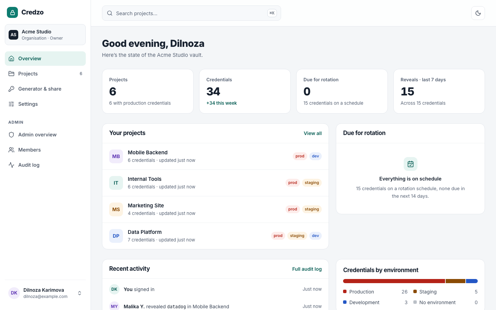
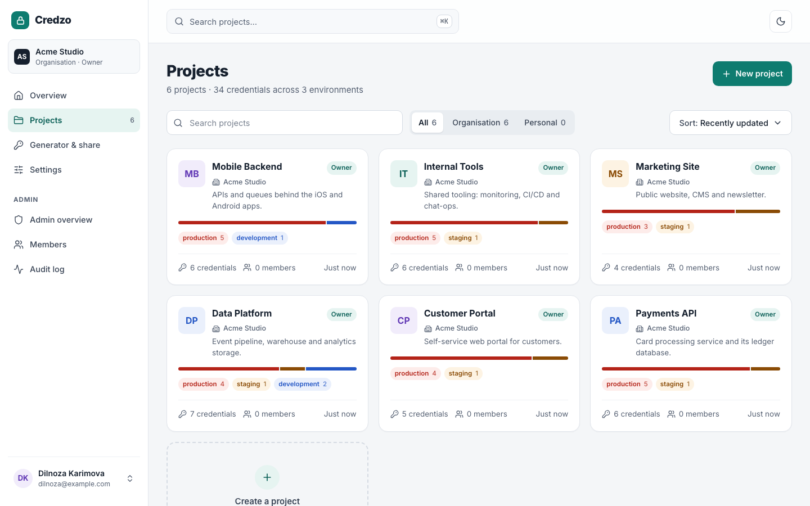
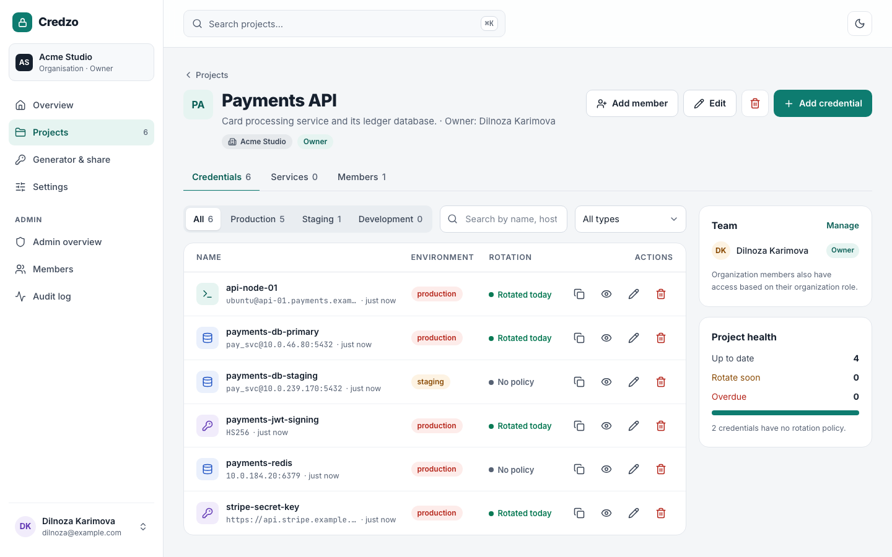
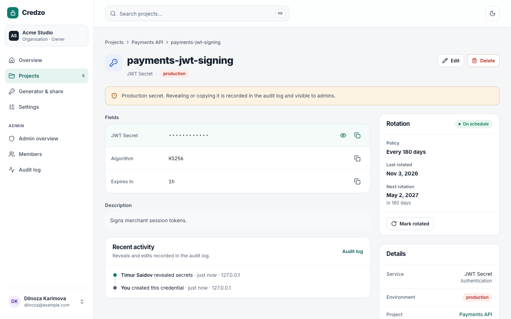
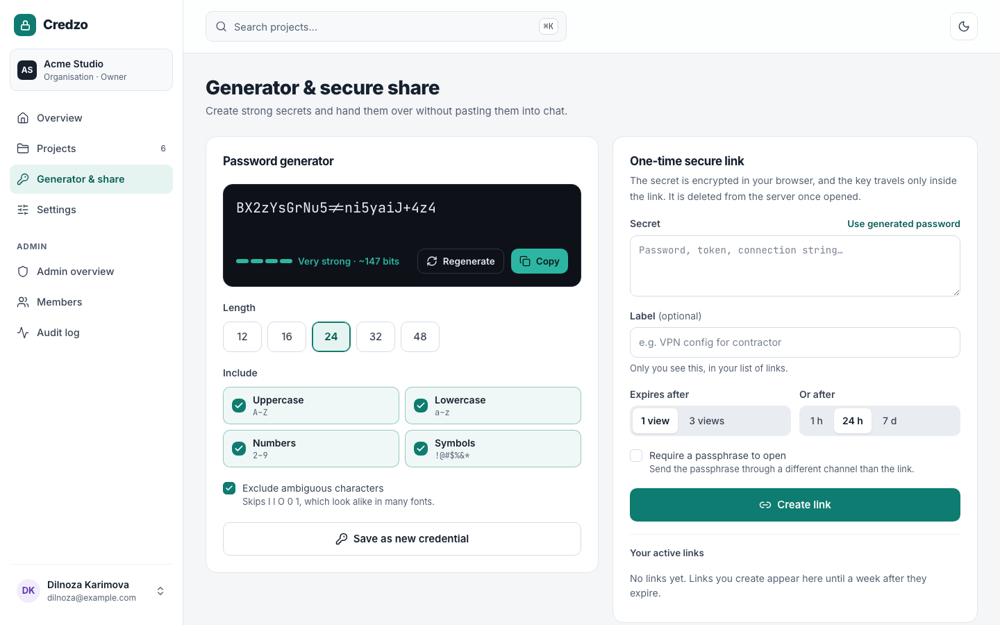
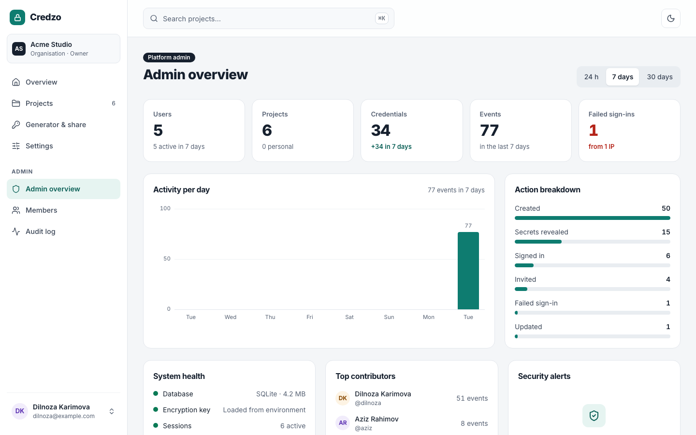
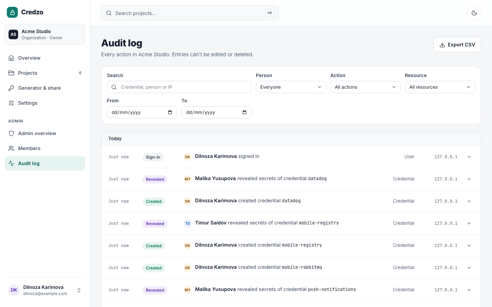
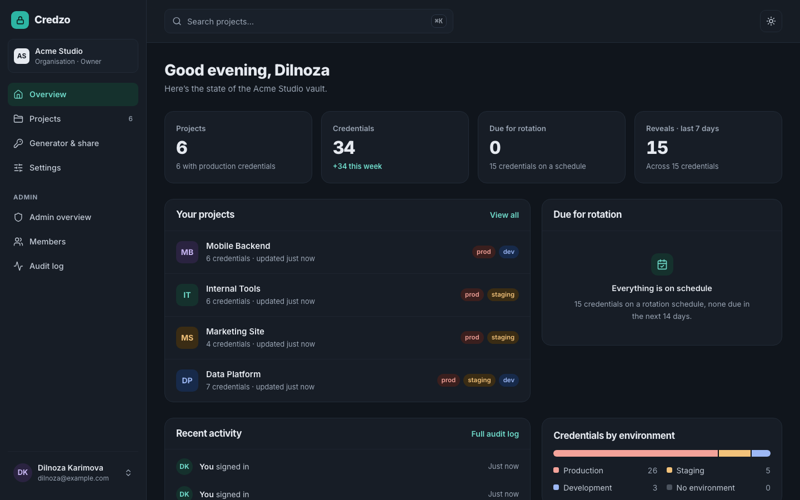
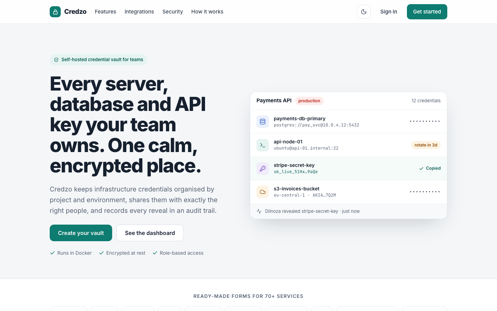

<div align="center">

# Credzo

**Self-hosted credential vault for DevOps teams.**
Every server, database and API key your team owns — organised by project and environment, encrypted at rest, shared by role and audited on every reveal.

[](https://github.com/ismoilovdevml/credzo/actions/workflows/ci.yml)




</div>

## Features

- **Projects & environments** — group credentials by project, split into production / staging / development.
- **70+ ready-made forms** — PostgreSQL, MySQL, Redis, SSH, Kubernetes, AWS, GCP, Kafka, SMTP and more.
- **Roles** — Owner, Admin, Member, Viewer at organisation level, plus per-project grants. Viewers can use a secret but never change it.
- **Audit log** — every create, edit, reveal, invite and sign-in with who, when and from which IP. Filter, search, export CSV.
- **One-time secure links** — encrypted in the browser, key only in the URL fragment, burned after 1 or 3 views.
- **Rotation reminders**, password generator, encrypted backup export/import, light & dark themes.

## Quick start

```bash
git clone https://github.com/ismoilovdevml/credzo.git && cd credzo
echo "CREDZO_ENCRYPTION_KEY=$(openssl rand -base64 32)" > .env
docker compose up -d
```

Open <http://localhost:3000> and sign up — **the first account becomes the platform admin.**
Back up `CREDZO_ENCRYPTION_KEY` together with the `credzo-data` volume: without the key stored secrets cannot be decrypted.

| Variable | Default | Purpose |
|---|---|---|
| `CREDZO_ENCRYPTION_KEY` | — (required in Docker) | 32-byte base64 master key for AES-256-GCM |
| `DATA_DIR` | `./data` (`/app/data` in Docker) | SQLite database location |
| `TRUST_PROXY` | `0` | Number of reverse proxies in front (set `1` behind nginx/Traefik/Caddy) |
| `COOKIE_SECURE` | on in production | Set `false` only for plain-HTTP on a trusted network |

## Security

| | |
|---|---|
| Passwords | scrypt with per-user salt, legacy hashes upgraded on sign-in |
| Secrets at rest | AES-256-GCM, masked in every API response, revealed only via an audited endpoint |
| Sessions | random tokens stored as SHA-256, httpOnly cookies, list & revoke in Settings |
| Sign-in | TOTP two-factor with one-time backup codes, rate limiting, no user enumeration |
| Requests | same-origin check on every mutation, strict security headers & CSP |

More in [docs/ARCHITECTURE.md](docs/ARCHITECTURE.md).

## Screenshots

| | |
|---|---|
|  |  |
|  |  |
|  |  |
|  |  |

## Development

Requires Node.js 22+.

```bash
npm ci
npm run dev                 # http://localhost:3000
npm run lint && npm run typecheck
npm run test:e2e            # builds, starts on :3100 with a throwaway DB, runs Playwright
npm run seed:demo           # demo org with 5 users and 6 projects (BASE_URL=…)
```

Stack: Next.js 16 (App Router) · React 19 · TypeScript · Tailwind CSS · SQLite (better-sqlite3) · Playwright.

## License

[MIT](LICENSE)
